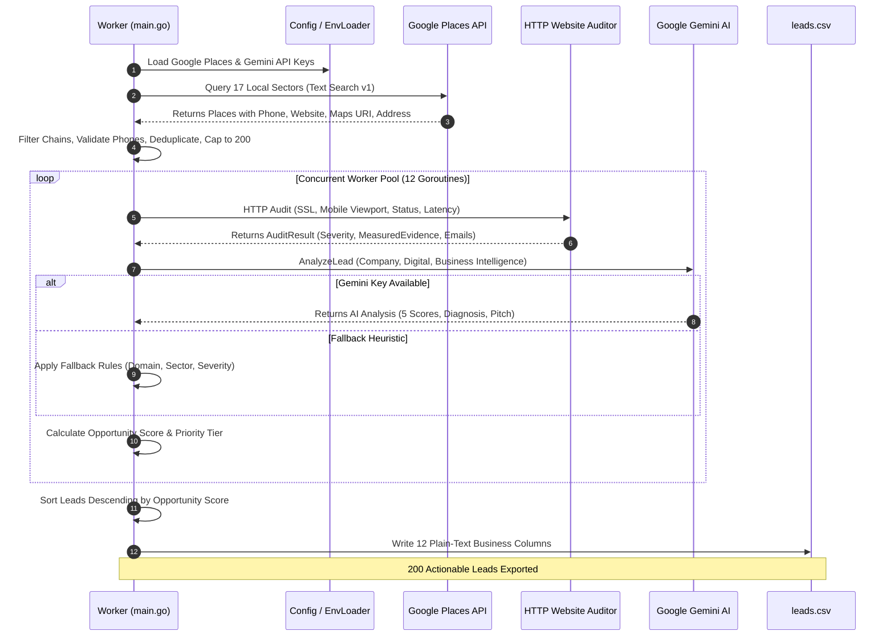

# DiverXen Lead Generation Engine — End-to-End System Audit

**Document:** Comprehensive Technical & Commercial Architecture Audit  
**Target File:** `audit.md` (Repository Root)  
**System Module:** `server/services/lead-generation`  
**Version:** DiverXen Growth System v1.0  
**Audit Date:** October 2026  

---

## 1. Executive Summary

The DiverXen Lead Generation Engine is an automated, concurrent Go microservice designed to discover high-value local commercial prospects, audit their digital presence and infrastructure health, evaluate their commercial fit and unmet technical need via AI, and export actionable, prioritized B2B sales leads.

The system targets high-ticket bespoke web application and digital modernization clients—primarily independent jewellery showrooms, luxury boutiques, dining venues, and healthcare clinics across the Kolkata metropolitan region.

```
┌─────────────────────────┐
│   Google Places API     │ (17 Commercial Search Queries)
└────────────┬────────────┘
             ▼
┌─────────────────────────┐
│ Gatekeeper & Filtering  │ (Block mega-chains, clean phones, deduplicate)
└────────────┬────────────┘
             ▼
┌─────────────────────────┐
│  HTTP Technical Auditor │ (Test SSL, mobile viewport, status code, latency)
└────────────┬────────────┘
             ▼
┌─────────────────────────┐
│ Google Gemini AI Engine │ (Score 5 pillars: Gap, Fit, Urgency, Reach, Confidence)
└────────────┬────────────┘
             ▼
┌─────────────────────────┐
│ DiverXen Scoring Model  │ (Weighted formula: 0-100 Score + Priority A/B/C/D)
└────────────┬────────────┘
             ▼
┌─────────────────────────┐
│    Clean leads.csv      │ (Plain-text business columns for sales reps)
└─────────────────────────┘
```

---

## 2. System Origin & Architecture Evolution

### 2.1 Technology Stack
- **Language:** Go (Golang 1.23+)
- **Architecture Pattern:** Clean / Hexagonal (Ports & Adapters) with Domain-Driven Design (DDD)
- **External APIs:**
  - Google Places API (New Text Search v1: `places.googleapis.com/v1/places:searchText`)
  - Google Gemini Generative Language API (`gemini-2.5-flash`)
  - OpenStreetMap Overpass API (secondary / fallback discovery provider)
- **Concurrency Model:** Go channels with a 12-worker goroutine pool and mutex synchronization.

### 2.2 Directory Layout
```
server/services/lead-generation/
├── cmd/
│   └── worker/
│       └── main.go                  # CLI entry point, worker pipeline, CSV export
├── internal/
│   ├── application/
│   │   ├── discovery/
│   │   │   └── service.go           # Orchestrates company discovery via ports
│   │   └── qualification/
│   │       ├── service.go           # Business qualification & scoring coordinator
│   │       └── service_test.go      # Qualification unit tests
│   ├── config/
│   │   ├── config.go                # API keys and .env auto-loader
│   │   └── config_test.go
│   ├── domain/
│   │   ├── company.go               # Company entity & validation
│   │   ├── contact.go               # Contact person model
│   │   ├── criteria.go              # Search filter criteria
│   │   ├── lead.go                  # Core Lead entity & qualification totals
│   │   ├── qualification.go         # Legacy 0-12 score validation & priority
│   │   ├── sales_lead.go            # Production SalesLead model & evaluation structs
│   │   └── trigger.go               # Buying trigger model
│   ├── infrastructure/
│   │   ├── ai/
│   │   │   ├── env_loader.go        # Gemini API key discovery (.env scanner)
│   │   │   ├── gemini_client.go     # Gemini 2.5 Flash API client & fallback heuristic
│   │   │   └── gemini_client_test.go
│   │   ├── auditor/
│   │   │   ├── website_auditor.go   # Raw HTTP client, SSL check, HTML parser
│   │   │   └── website_auditor_test.go
│   │   ├── googleplaces/
│   │   │   ├── client.go            # Text search with field masking & pagination
│   │   │   ├── mapper.go            # Maps Places API JSON to domain.Company
│   │   │   ├── models.go            # Places request/response DTOs
│   │   │   └── client_test.go
│   │   └── openstreetmap/
│   │       ├── client.go            # Overpass QL runner with multi-endpoint failover
│   │       ├── mapper.go            # OSM node/way tag extraction
│   │       └── models.go
│   └── ports/
│       ├── auditor.go               # WebsiteAuditor interface & AuditResult struct
│       ├── company_source.go        # CompanySource interface
│       └── lead_repository.go       # Storage interface
├── leads.csv                        # Final exported dataset (200 records)
└── worker.exe                       # Compiled binary
```

### 2.3 Commit Lineage & Iterations
1. **Initial Monorepo Setup (`bfeb960`):** Established domain models (`domain.Company`, `domain.Lead`, `domain.Qualification`), ports, and discovery client using OpenStreetMap and basic Google Places.
2. **Growth System Switch (`7c834c7`):** Switched discovery strictly to Google Places (New) API for verified commercial data; added HTTP website auditor; built Gemini client; implemented weighted 5-factor scoring model.
3. **Sales Optimization (`1c0034a`):** Refined `cmd/worker/main.go` to eliminate technical jargon; filtered out national corporate conglomerates; generated plain-text sales pitches and service requirements in `leads.csv`.

---

## 3. Inputs Given to the System

### 3.1 Environment & API Credentials
The worker searches runtime environment variables and candidate `.env` files (`.env`, `../../.env`, `f:/DEV/DIVERXEN/.env`):
- `GOOGLE_PLACES_API_KEY` or `GOOGLE_MAPS_API_KEY`: Authenticates calls to Google Places API (v1).
- `GEMINI_API_KEY` or `GEMENI_API_KEY`: Authenticates calls to Google Generative Language API (`gemini-2.5-flash`).

### 3.2 Geographic & Sector Search Parameters
The system executes targeted search queries for independent commercial sectors in **Kolkata, West Bengal**:
- `jewellery showroom in Kolkata, West Bengal`
- `gold diamond jewellery shop in Kolkata, West Bengal`
- `designer boutique clothing store in Kolkata, West Bengal`
- `bridal sarees and lehengas in Kolkata, West Bengal`
- `ethnic wear boutique in Kolkata, West Bengal`
- `independent cafe in Kolkata, West Bengal`
- `bistro and bakery in Kolkata, West Bengal`
- `local restaurant in Kolkata, West Bengal`
- `rooftop cafe in Kolkata, West Bengal`
- `interior design studio in Kolkata, West Bengal`
- `furniture showroom in Kolkata, West Bengal`
- `home decor showroom in Kolkata, West Bengal`
- `beauty salon and spa in Kolkata, West Bengal`
- `dental clinic in Kolkata, West Bengal`
- `diagnostic center and healthcare clinic in Kolkata, West Bengal`
- `gym and fitness studio in Kolkata, West Bengal`
- `catering and banquet services in Kolkata, West Bengal`

### 3.3 Google Places Payload & Field Mask
The search request is dispatched via HTTP POST to `https://places.googleapis.com/v1/places:searchText`:
```json
{
  "textQuery": "<industry query> in Kolkata, West Bengal",
  "pageSize": 20,
  "pageToken": "<nextPageToken>"
}
```
Field mask requested:
- `places.id`
- `places.displayName`
- `places.formattedAddress`
- `places.websiteUri`
- `places.nationalPhoneNumber`
- `places.internationalPhoneNumber`
- `places.primaryType`
- `places.types`
- `places.googleMapsUri`
- `places.location`
- `nextPageToken`

Up to 3 pages (60 raw places) are fetched per query until target pool bounds are reached.

---

## 4. Ingestion, Gatekeeping & Normalization

To ensure high lead quality, raw Google Places data is passed through multiple validation filters:

### 4.1 Conglomerate & Mega-Chain Blacklist Filter (`isCorporateOrChain`)
Corporate brand branches cannot commission local web development. The worker filters out entities matching known corporate domains or brand keywords:
- **Hotels:** Taj, Marriott, Hyatt, ITC Sonar/Royal Bengal, Oberoi Grand, Novotel, Radisson Blu, Hilton, Holiday Inn.
- **National Jewellery Chains:** Tanishq, BlueStone, CaratLane, Kalyan Jewellers, Malabar Gold, Joyalukkas, PC Chandra, Senco Gold.
- **Fast Food Franchises:** McDonald's, Domino's, KFC, Pizza Hut, Starbucks, Subway, Burger King, Barbeque Nation, Mainland China.
- **National Retail:** Zara, H&M, Forever 21, Pantaloons, Shoppers Stop, Westside, Reliance Retail, Tata CLiQ, Myntra, Amazon, Flipkart, Bata.

### 4.2 Deduplication
Deduplication is performed at two layers:
1. Google Place ID (`c.ID`) tracking.
2. Normalized, lower-case company name tracking (`seenNames[normName]`).

### 4.3 Phone Number Normalization (`cleanAndValidatePhone`)
- Corrects OCR and regional mismatches (e.g., converting accidental `+31 33` to India Kolkata landline `+91 33`).
- Splits multi-number strings (`/`, `;`, `,`).
- Strips non-digit formatting characters.
- Requires digit lengths between 8 and 15 digits. Multiples are rejoined cleanly with `" / "`.

### 4.4 Email Validation (`isValidEmailAddress`)
Validated against the RFC-compliant regex:
```regex
^[a-zA-Z0-9._%+\-]+@[a-zA-Z0-9.\-]+\.[a-zA-Z]{2,}$
```

### 4.5 Gatekeeping Rule
A candidate is retained **only** if it possesses at least one valid communication channel or verifiable web footprint:
$$\text{Candidate Retained} \iff (\text{Valid Phone} \lor \text{Valid Email} \lor \text{Valid Website} \lor \text{Valid Google Profile})$$

The candidate pool is capped at a maximum of **200 qualified clients**.

---

## 5. Digital Technical Audit Engine

Every candidate is processed through `HTTPWebsiteAuditor.Audit(ctx, company)`:

### 5.1 Presence Classification
The auditor distinguishes owned domains from third-party profiles:
| URL Pattern | Presence Type | Impact |
|---|---|---|
| Domain host (e.g., `ncbjeweller.com`) | `PresenceOwnedWebsite` | Candidate for deep HTTP & SSL audit |
| `facebook.com`, `instagram.com` | `PresenceSocialPage` | Flags lack of owned web authority |
| `maps.google`, `g.co/...` | `PresenceGoogleProfile` | Flags business active only on Google Maps |
| `*.business.site` | `PresenceGoogleProfile` | **Critical:** Defunct site shutdown by Google |
| `justdial.com`, `zomato.com`, `swiggy.com` | `PresenceDirectory` | Third-party platform dependency |
| Empty string / missing | `PresenceNone` | Zero web presence detected |

### 5.2 Deep HTTP Audit (For Owned Domains)
An HTTP client with `InsecureSkipVerify: true`, 8-second timeout, and up to 5 redirects executes an inspection:
1. **SSL/HTTPS Check:** Verifies scheme is `https://`. Missing SSL flags `HasHTTPS = false` and `TechnicalSeverity = High`.
2. **Server Availability & Latency:** Measures round-trip time in milliseconds (`ResponseTimeMs`). Latency $> 2500\text{ms}$ flags `TechnicalSeverity = Medium`.
3. **HTTP Status Code:** Inspects response code:
   - `400-499` (e.g., 402, 403, 404): `TechnicalSeverity = Critical`
   - `500-599`: `TechnicalSeverity = Critical`
   - Network failure/timeout: `TechnicalSeverity = Critical`
4. **Mobile Responsiveness Check:** Reads up to 256 KB of the HTML response:
   - Checks for `<meta name="viewport" ...>` tag.
   - If present: `IsMobileFriendly = true`, `MobileReadiness = 8` (or `9` if `@media`/`flex` detected).
   - If absent: `IsMobileFriendly = false`, `MobileReadiness = 2`.
5. **Contact Scraping:**
   - Extracts business emails via regex `[a-zA-Z0-9._%+\-]+@[a-zA-Z0-9.\-]+\.[a-zA-Z]{2,}`.
   - Strips image asset false positives (`.png`, `.jpg`, `.svg`, `sentry.io`, `wixpress.com`).
   - Extracts social profile URLs (Instagram, Facebook, LinkedIn).

---

## 6. What the AI Does (Gemini Intelligence Engine)

### 6.1 Model & Configuration
- **Model:** `gemini-2.5-flash`
- **Temperature:** `0.2` (low temperature for deterministic, factual outputs)
- **Response Format:** `application/json` (enforced via Gemini schema)

### 6.2 The Prompt & Persona
The prompt positions the AI as DiverXen's **Principal Lead Evaluation & B2B Sales Architect** operating under the DiverXen Growth System v1.0.

The AI receives complete structured data:
- Business Identity (Name, Industry, Sub-Industry, Address, Phone, Email, Presence Type, Owned Domain).
- Technical Audit Metrics (HTTP Status, Latency, HTTPS state, Mobile Readiness, Technical Severity, Measured Evidence, Detected Errors).
- Business Scale Indicators (Physical showroom size, prime location signals like Park Street or Camac Street).

### 6.3 AI Decision Responsibilities
1. **Score 5 Independent Dimensions (0-100 scale):**
   - **Opportunity Gap ($0-100$):** Measures the severity of the digital deficit.
   - **Commercial Fit ($0-100$):** Alignment with DiverXen's bespoke services and local owner authority.
   - **Buying Urgency ($0-100$):** Immediate triggers (broken site, dead `.business.site`, no direct booking).
   - **Contactability ($0-100$):** Reachability of the decision-maker via direct phone or email.
   - **Evidence Confidence ($0-100$):** Level of certainty based on verifiable metrics.
2. **Ownership & Procurement Verification:** Confirms whether the entity is `Independent`, `Local Chain`, `Franchise`, or `Corporate Branch`. If a corporate branch is identified, Commercial Fit is capped.
3. **Structured Sales Diagnosis:**
   - `observed_issue`: Exact digital breakdown.
   - `evidence`: Specific metric (e.g., `HTTP 403`, `Latency: 2800ms`, `MobileViewport: false`).
   - `business_impact`: Commercial consequences (e.g., losing margin to 25%+ Zomato commission, lost footfall).
   - `recommended_service`: Targeted DiverXen offering.
   - `quick_win`: Fast 24-48h deliverable to get a foot in the door.
   - `larger_opportunity`: Comprehensive web app engagement.
   - `outreach_pitch_angle`: Tailored cold outreach angle.

### 6.4 Deterministic Fallback Heuristic
If the Gemini API key is missing or an API error/timeout occurs, `gemini_client.go` executes `fallbackHeuristic()`:
- Evaluates industry type (Jewellery, Restaurant, Boutique, Specialty).
- Computes Contactability: 90 (Phone + Email), 65 (Phone only), 60 (Email only), 20 (Neither).
- Computes Evidence Confidence: 92 (Verified with HTTP code), 78 (Supported by domain), 62 (Probable).
- Applies deterministic opportunity gaps and service mappings based on audit severity.

---

## 7. Mathematical Calculations & Scoring Formulas

The DiverXen Lead Qualification model uses a weighted linear combination of five independent pillars:

### 7.1 The Opportunity Score Formula
$$\text{OpportunityScore} = (0.35 \times \text{Gap}) + (0.25 \times \text{Fit}) + (0.15 \times \text{Urgency}) + (0.15 \times \text{Reach}) + (0.10 \times \text{Confidence})$$

Where:
- $\text{Gap} \in [0, 100]$: Opportunity Gap (Weight: 35%)
- $\text{Fit} \in [0, 100]$: Commercial Fit (Weight: 25%)
- $\text{Urgency} \in [0, 100]$: Buying Urgency (Weight: 15%)
- $\text{Reach} \in [0, 100]$: Contactability Score (Weight: 15%)
- $\text{Confidence} \in [0, 100]$: Evidence Confidence (Weight: 10%)

### 7.2 Gatekeeping Conditions & Priority Routing
The system assigns each lead a Priority Tier and Next Action:

```
                                  [ Lead Candidate ]
                                          │
                         Is Corporate Chain Branch?
                                ├── YES ──► Priority D (Fit capped at 20)
                                └── NO
                                          │
                         Operational Status Closed/Uncertain?
                                ├── YES ──► Priority Review
                                └── NO
                                          │
                             Evidence Confidence < 50?
                                ├── YES ──► Priority Review
                                └── NO
                                          │
                   Score >= 75 AND Confidence >= 60 AND Reach >= 40?
                                ├── YES ──► Priority A ("High")
                                └── NO
                                          │
                                    Score >= 60?
                                ├── YES ──► Priority B ("Warm")
                                └── NO
                                          │
                                    Score >= 45?
                                ├── YES ──► Priority C ("Moderate")
                                └── NO
                                          ▼
                                     Priority D
```

| Tier | Priority Label | Score Range | Mandatory Gates | Actionable Pipeline Step |
|---|---|---|---|---|
| **Tier 1** | **High (Priority A)** | $75.0 - 100.0$ | Confidence $\ge 60$, Reach $\ge 40$, Non-corporate | Immediate personalized outreach & owner consultation |
| **Tier 2** | **Warm (Priority B)** | $60.0 - 74.9$ | Non-corporate | Enrich contact data before outreach |
| **Tier 3** | **Moderate (Priority C)** | $45.0 - 59.9$ | — | Nurture and monitor for buying trigger |
| **Tier 4** | **Low (Priority D)** | $< 45.0$ | Corporate chain or low need | Do not spend active sales time |
| **Review** | **Priority Review** | Any | Confidence $< 50$ or Closed | Manual verification of business status |

---

## 8. Output Generation & Export Pipeline

The worker consolidates all audited leads, sorts them, and generates `server/services/lead-generation/leads.csv`:

### 8.1 Sorter
All leads are sorted in descending order:
$$\text{leads}[i].\text{Score} \ge \text{leads}[j].\text{Score} \quad \forall \; i < j$$

### 8.2 Plain-Text Business Translation
Technical variables are translated into clean business terminology:
- **`Category`:** Categorized based on name and industry keywords into `Jewellery Showroom`, `Boutique & Fashion`, `Cafe & Bakery`, `Restaurant & Dining`, `Interior Design & Furniture`, `Healthcare & Clinic`, `Beauty & Wellness`, `Fitness & Gym`, or `Local Business`.
- **`Digital Status`:** Derived from presence type, status code, SSL, and mobile viewport:
  - `Website Blocked (Server Misconfigured)` (HTTP 403)
  - `Website Broken (Page Not Found / Dead Link)` (HTTP 404)
  - `Website Down (Expired Domain / Billing Issue)` (HTTP 402)
  - `Insecure Website (Missing SSL Certificate)`
  - `No Website (Active on Google Maps only)`
  - `Outdated Website (Needs Modern Web App & UX Upgrade)`
- **`Service Needed`:** Mapped from digital status and category:
  - `Emergency Website Rebuild & Cloud Migration`
  - `SSL Security Installation & Full-Stack Modernization`
  - `Bespoke Digital Showroom & VIP Consultation Portal` (Jewellery)
  - `Direct Online Ordering & Table Booking Web App` (Dining)
  - `Conversion Optimization & Interactive Web Redesign`
- **`Sales Pitch`:** Specific, non-technical pitch statement ready for email, phone, or WhatsApp cold outreach.

### 8.3 CSV Schema (12 Columns)
```csv
Company Name,Category,Priority,Score,Phone,Email,Website,Google Maps Link,Address,Digital Status,Service Needed,Sales Pitch
```

### 8.4 Output Distribution in Current Run (`leads.csv`)
- **Total Discovered:** 280+ raw local businesses
- **Normalized Candidates Retained:** 200 high-quality commercial prospects
- **🔥 High Priority (Score 75–87):** 25 leads (broken websites, missing SSL, zero-website jewellery showrooms)
- **⚡ Warm Priority (Score 60–74):** 173 leads (static sites requiring modern web applications and CRO)
- **📋 Moderate Priority (Score 55):** 2 leads

---

## 9. End-to-End Dataflow Diagram



---

## 10. Audit Findings & Recommendations

### 10.1 Key Strengths
1. **Architectural Separation:** Clean Hexagonal structure decouples external data providers (Google Places / OSM) and AI providers (Gemini) from core domain scoring logic.
2. **True Business Validation:** The corporate conglomerate filter prevents wasting outreach resources on branch locations that cannot purchase local web services.
3. **Evidence-First Scoring:** The auditor verifies real HTTP metrics, SSL presence, and mobile viewports before AI evaluation, preventing hallucinations.
4. **Deterministic Fallback:** The engine gracefully falls back to deterministic rule-based evaluation if Gemini rate limits or network errors occur.

### 10.2 Discovered Vulnerabilities & Enhancement Opportunities
1. **Notion CRM Integration Incomplete:** The files in `internal/infrastructure/notion/` are currently stubs (16 bytes). An adapter should be implemented to push leads directly to Notion CRM alongside the CSV export.
2. **Dynamic Query Expansion:** Search queries are currently hardcoded to Kolkata. Parameterizing the city/location via CLI flags (`-location="Mumbai"` `-limit=200`) will allow multi-city expansion.
3. **Deep Page Crawling:** The website auditor currently checks only the root URL (`/`). Expanding to crawl `/contact` or `/about` could increase email extraction rates beyond the current 25%.
4. **WhatsApp Automation Hook:** Integrating the exported CSV with a WhatsApp Business API webhook could automate initial personalized outreach using the generated `Sales Pitch`.

---
*Audit complete. Generated for DiverXen core engineering.*
